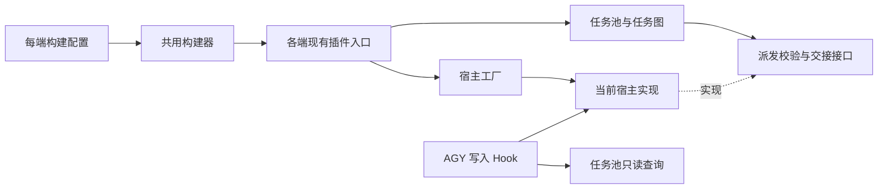

# 三宿主配置驱动适配设计

本文是供评审的设计稿。现状以源码提交 `2828021` 和已发布的 `xy-workflow 3.0.9` 为基准。本次设计针对 Codex、Claude Code 和 Antigravity，目标是复用公共实现，把每端独属的配置与行为收回自己的目录。用户看到的工作流、正式安装入口和发行方式沿用现有方案。当前架构和已发布结果分别以现有文档为准。[当前代码架构](../ARCHITECTURE.md) · [开发与构建手册](../development.md) · [3.0.9 发行记录](stable-product-release.md#309-与-017-发行及本机验收)

## 1. 需要拆开的现有依赖

| 当前代码 | 从调用关系看到的问题 | 设计落点 |
| --- | --- | --- |
| `packaging/build_plugin.py` | 同一个构建器掌管公共文件和各宿主的清单、资源投影、入口。公共 `HOST_LIB_FILES` 会把 `antigravity_dispatch.py` 装进三端。 | 保留同一个构建器。各宿主用自己的配置声明包内布局和资源选择。 |
| `lib/task_pool.py`、`lib/dispatch_admission_cli.py`、`lib/task_graph_cli.py` | 任务状态更新直接识别 AGY 物理安装、派发标记和原生回执。 | 任务池掌管状态和提交，由当前宿主的校验实现提供派发证据。 |
| `plugins/antigravity/write_guard.py` | Hook 直接读任务池 `_index` 和 `_read_pool`，也直接取交接目录的内部常量。 | 让 Hook 从公开的只读查询获得任务快照，从同一交接策略获得目录规则。 |
| `native_config/preference_contract.py` | 一个文件同时处理偏好格式、宿主配置根、模型档位和操作系统文件访问。插件与独立配置组件又共用这份源。 | 先在同一文件内理顺职责及调用方向，保留现有同源投影和加载入口。 |

[构建器](../../packaging/build_plugin.py) · [任务池](../../lib/task_pool.py) · [派发准入](../../lib/dispatch_admission_cli.py) · [AGY Hook](../../plugins/antigravity/write_guard.py) · [偏好合同](../../native_config/preference_contract.py)

## 2. 拟议目录与依赖方向

下面只列涉及本次边界的目录。标有「拟增」的是实施时拟新增的模块，未列出的现有目录沿用当前布局。

```text
product/                          工作流、角色身份和插件版本的权威源
roles/                            三端共用的角色正文
platforms/
  shared/                        公共 Skill、标准和工作流指引
  codex/                         Codex 专属原生接入指引
  claude/                        Claude Code 专属原生接入指引
  antigravity/                   AGY 专属原生接入指引
plugins/
  source_pack.py                 现有官方包入口，复用来源验证并组装当前宿主
  codex/
    host_profile.json            拟增，Codex 构建配置
    plugin.json.in               现有清单模板
    hooks/                       现有 SessionStart Hook 源码
  claude/
    host_profile.json            拟增，Claude 构建配置
    plugin.json.in               现有清单模板
    pm.md、settings.json          现有原生入口配置
  antigravity/
    host_profile.json            拟增，AGY 构建配置
    plugin.json.in、hooks.json    现有清单与 Hook 声明
    write_guard.py、guard_command.py
  maintenance/                   现有独立配置组件薄入口
lib/
  task_pool.py                   公共任务池与公开的只读查询
  task_graph*.py、task_intent.py  公共任务记录与状态转换
  hosts/
    capabilities.py              现有宿主能力诊断
    factory.py                   拟增，入口组装与当前宿主选取
    dispatch_contract.py         拟增，派发校验接口与旧记录格式兼容
    handoff.py                   拟增，交接位置接口与现有共用目录操作
    antigravity_dispatch.py      现有模块收拢 AGY 派发凭据与原生日志校验
    antigravity_handoff.py       拟增，选择 AGY 的当前和兼容交接位置
native_config/
  preference_contract.py         保留同源入口，内部划分偏好规则、宿主与文件访问
packaging/
  build_plugin.py                同一个流水线读取当前宿主配置并生成原格式产物
```

源代码目录与安装包目录分别维护。比如 AGY 的源码入口仍是 `plugins/antigravity/write_guard.py`，在安装包里依旧是 `hooks/write_guard.py`。拟新增的工厂只在入口组装依赖。共享任务池、任务图与记录层使用已经组装好的校验接口。Codex 和 Claude 共用目前已有的默认实现，出现真实行为差异时再提供专属实现。



安装包中的宿主身份由物理包根、现有原生清单和来源记录核对。构建器随包写入唯一宿主的组装入口，并将其计入 `sources.json` 的载荷校验。工厂只使用该入口，宿主、清单或载荷不匹配时按入口的既有错误方式拒绝。项目配置、`--pm-id` 和 `--host` 等业务参数仍按原合同校验。`dispatch-preferences --host` 仍是偏好读取的目标参数。CLI 复用现有的来源核验，AGY Hook 复用同一宿主选择规则，并在原生入口核对其依赖的固定资源，避免每次调用都扫描整个安装包。源码运行和测试沿用现有入口，测试可以显式注入实现。[包内入口与来源验证](../../plugins/source_pack.py) · [AGY 物理包识别](../../lib/hosts/antigravity_dispatch.py)

## 3. 共享边界与三端配置

| 职责 | 三端共享 | 由各端决定 |
| --- | --- | --- |
| 工作流与角色 | Light／Full、批准、容量、所有权、QA、交付及角色正文 | 原生角色发现方式、角色正文的宿主投影、主会话入口 |
| 任务领取和绑定 | 任务池登记、状态转换、唯一绑定检查、原件 SHA-256 和比较后写入（CAS） | 原生证据如何生成和核对。AGY 校验创建回执，Codex 和 Claude 采用各自当前的绑定条件 |
| 文件所有权与 Hook | 任务范围、角色类型、状态、执行根的查询语义 | Hook 的宿主事件、工具参数、执行判断及响应。Codex 保留 SessionStart，AGY 保留 PreToolUse |
| 任务交接 | 规范项目根、请求槽位、目录安全、原件读写、按摘要预览和清理 | Codex 和 Claude 沿用系统临时交接目录。AGY 的新交接进入 `.awf/agy-requests/`，在途旧交接仍按现有兼容规则读取和清理 |
| 调用偏好 | 当前 JSON 格式、按字段继承、来源标记、物理项目键与安全读取 | 配置根及允许值，例如 Codex 的 `CODEX_HOME`、Claude 的 `CLAUDE_CONFIG_DIR`、AGY 的配置根和模型档位 |
| 打包和安装 | 插件身份、版本、载荷摘要、来源锁、构建及现有发行流程 | 官方清单布局、资源装配、市场索引形状与稳定来源入口 |

| 宿主 | 沿用的包内入口 | 该端的适配范围 |
| --- | --- | --- |
| Codex | `.codex-plugin/plugin.json`、`hooks/hooks.json`、`native-agent-templates/codex/` | Skill 发现、SessionStart Hook 和官方信任流程、原生角色模板投影。普通派发校验和临时交接目录复用当前共用实现。 |
| Claude Code | `.claude-plugin/plugin.json`、`settings.json`、`agents/pm.md` | PM 默认入口、角色投影与市场索引的 Claude 格式。普通派发校验和临时交接目录复用当前共用实现。 |
| AGY | `.antigravity-plugin/plugin.json`、`rules/AGENTS.md`、根目录 `hooks.json` | 主会话规则与角色投影、PreToolUse 写入分工、原生派发凭据和项目内交接策略。 |

[三端现有安装入口](../../plugins/INSTALL.md) · [宿主资源构建](../../packaging/build_plugin.py)

### 任务原件、池索引与交接件的存放

本轮把现有路径、写入入口和保留条件写成共同约定。任务池按**项目物理路径和显式 PM 身份**隔离，三端使用同一套存储规则。适配器只决定本端的交接位置，并按现有方式校验本端的原生派发证据。

```text
<系统临时根>/agent-workflow-request-scratch/<项目键>/
  task-pools/<PM 摘要>/index.json           任务池索引
  request-<请求摘要>/                      Codex、Claude 和在途旧 AGY 交接
<项目物理根>/.awf/agy-requests/
  request-<请求摘要>/                      新 AGY 交接
```

项目键由物理项目路径派生，PM 键和请求槽名分别使用对应身份和逻辑请求 ID 的摘要。AGY 项目内交接继续沿用本地 `.gitignore` 规则。Light 原包或 Full 原图的位置以登记时的物理绝对路径为准。原件如果放在请求目录里，仍须按原件的保留条件处理。[任务池索引](../../lib/task_pool.py) · [请求目录规则](../../lib/task_graph_records.py)

| 对象 | 存放与职责 | 保留和清理 |
| --- | --- | --- |
| 任务原件 | PM 登记现有 Light 原包或 Full 原图。共享任务记录命令在原路径按摘要校验和更新。任务状态、所有权、领取和绑定从当前原件读取。 | 登记期间保留原路径。池归档只移除符合终态、占用和引用检查的索引项，原件与工作成果继续留在原处。 |
| 任务池索引 | 以项目和 PM 为范围，记录原件定位、标题及成员绑定。共享任务池维护索引，查询和准入按登记路径回读原件。 | 独立于请求目录。按请求清理和项目临时目录的 `--all` 清理均只处理现有的请求槽范围。 |
| 交接包与领取回执 | 导出的任务包、领取回执和临时交接文件放进当前请求目录。AGY 按现有规则选择当前目录和兼容位置。 | 按请求收口。AGY 按请求清理时优先当前项目内目录，只有当前目录不存在才回退到在途旧位置。 |
| 验收及原生证据 | 已有 QA 合同按其引用的物理路径及内容摘要核验任务包和交接证据。原生会话记录由宿主管理，适配器按本端规则读取所需证据。 | 仍在被核验的证据保持原路径和原字节，或先按现有流程转交并更新引用。任务目录的清理范围仅限该请求有权处置的文件。 |
| 写入互斥与任务占用 | 现有目录协作锁保护索引事务和原件发布。执行根、路径所有权和语义锁参与任务池的占用判断。 | 进程退出时释放目录协作锁。任务占用继续依据原件及已核实的宿主结果处理。 |

**恢复与收口。** 已知有在途任务时，索引或原件缺失、损坏都先核对登记清单、可信原件和宿主实例。项目临时根被系统回收时，按现有规则由 PM 重新盘点。核实前保留未知占用。清理时由 PM 核对归属、引用及写入者已停止，沿用 `cleanup-scratch` 的预览和校验参数。仍须保留的原件或证据在两次命令中使用同一组 `--keep`。预览摘要绑定实际目录，新旧位置各自核验。[任务池派发与恢复](../../platforms/shared/skills/xy-workflow/references/dispatch.md) · [请求目录清理](../../platforms/shared/skills/xy-workflow/references/runtime-records.md#allocate-and-clean-up-the-task-scratch-workspace) · [QA 证据核验](../../lib/foundation_qa.py)

### 配置形状与允许覆盖的字段

构建配置由发布源码提供。字段限定为宿主标识、官方清单目标、资源上下文入口、固定资源的源路径与目标路径。清单字段与模板正文继续由对应的 `plugin.json.in` 管理。角色投影等已有变换继续由构建器执行，可通过有限的枚举选定；可选变换及目标路径由构建代码按宿主校验。

下面是 AGY 配置的拟议最小形状，省略其他原样复制项。

```json
{
  "schema_version": 1,
  "host": "antigravity",
  "manifest_target": ".antigravity-plugin/plugin.json",
  "resource_context_source": "plugins/antigravity/plugin-context.md",
  "resources": [
    {"source": "plugins/antigravity/hooks.json", "target": "hooks.json"},
    {"source": "plugins/antigravity/write_guard.py", "target": "hooks/write_guard.py"},
    {"source": "plugins/antigravity/guard_command.py", "target": "hooks/guard_command.py"}
  ]
}
```

配置中的宿主须与构建目标一致。构建器拒绝未知字段、重复目标、路径越界、链接、伪造其他宿主清单，以及覆盖共享权威文件的映射。实际 Hook 命令保留在宿主的原生声明里。领取、文件所有权、证据验证和 QA 门禁继续由代码和现有产品规则判断。调用偏好中的宿主根和模型档位由两种产品共用的偏好合同维护，避免在打包配置中复制一套取值规则。[当前清单及投影](../../packaging/build_plugin.py) · [共同产品身份](../../product/command_identity.json)

## 4. 接口按现有调用划分

| 边界 | 输入与输出 | 权限和失败行为 |
| --- | --- | --- |
| 派发校验 | 当前项目和执行根、PM 身份、目标记录与原件摘要、角色、已有领取/回执及候选实例。输出现有领取扩展字段和回执标记，或返回校验结果。 | 任务池保留锁、状态转换和 CAS 写入。适配器核对原生证据，使用现有失败语义。原生创建结果未知时保留占用。 |
| 交接位置 | 物理项目根、请求 ID 和当前操作。产出当前目录及适用的兼容目录。 | 共用存储操作负责创建、检查和清理。AGY 策略复用现有项目内路径、路径优先级和旧目录兼容。 |
| Hook 只读查询 | 物理项目根、PM 身份。返回已登记记录的快照，包含记录身份、任务及请求 ID、执行根、状态、角色、所有权、领取凭据和绑定引用。 | 只读打开已存在的索引，一次查询下完成锁内读取。不返回内部索引、文件句柄或写入口。索引缺失、原件损坏与空结果保留可区分的诊断。 |

以 AGY 绑定为例，任务池先核对已登记原件、当前领取和已有实例占用。AGY 实现按当轮凭据核对父会话、子会话、角色、执行根与原生创建日志。任务池随后通过同一记录更新路径登记 `agent_ref`。同轮同 ID 的幂等重试维持原协议。AGY Hook 取到只读快照后释放池锁，再继续原生身份核验与文件判断，保留当前对未绑定实现者、已绑定实现者和 QA 只读角色的处理。[绑定入口](../../lib/task_pool.py) · [原生证据校验](../../lib/hosts/antigravity_dispatch.py) · [Hook 任务核对](../../plugins/antigravity/write_guard.py)

**已有记录格式继续兼容。** 原任务 `schema_version: 2`、领取回执 `schema_version: 1` 和保存过的 `antigravity_claim`、`dispatch_marker`、`agent_ref` 都按原合同解释。公共兼容校验保留 AGY 历史字段的格式和语义，包括父子身份不能相同。读取历史记录只需要这部分数据校验。原生日志解析和新的 AGY 操作从 AGY 实现进入。公开 `update`、覆盖导出、首次绑定、释放和独立 QA 的保护要一起迁移，避免只改 `bind` 时漏掉旁路。移除非 AGY 包里的 AGY 原生校验前，先核对现有脚本和已记录调用方是否直接使用该能力，并为发现的合法调用保留同等的入口行为。[历史字段与控制操作](../../lib/task_intent.py) · [公开更新和导出](../../lib/task_graph_cli.py) · [记录发布保护](../../lib/task_graph_records.py)

### 调用偏好的迁移边界

首轮保留 `native_config/preference_contract.py` 作为唯一可执行源，继续原样投影到 `plugins/dispatch_preferences.py`。文件内把宿主根及允许值、四层继承、文件安全读取分开；现有逻辑优先级为用户默认 → 用户身份 → 项目默认 → 项目身份，按字段覆盖。这能保留插件只读子命令和独立组件的精确依赖闭包。macOS Python 的目录访问兼容保留在文件访问部分，宿主路径策略使用同一读法。配置文件位置、已有内容、脱敏错误、`runtime_verified` 和现有写入保护都沿用当前语义。[偏好解析与读取](../../native_config/preference_contract.py) · [插件只读入口](../../plugins/source_pack.py) · [独立组件构建](../../packaging/build_agent_config.py)

## 5. 迁移顺序与验收

每步都可以单独检查和回退。目录移动随对应职责迁移完成，现有公开入口保留原路径。实施基线在开始时记录源码提交、三端实际包清单及关键正反例，再做逐步对照。

| 顺序 | 处理现有代码 | 通过条件 |
| --- | --- | --- |
| 1. 收拢装配配置 | 从 `build_plugin.py` 提取三端固定清单目标、资源选择和入口映射到各自配置。保留清单模板和固定变换，继续使用原有构建及发布器。 | 三端官方发现入口、原生清单、角色、Hook、安装源布局和执行位与基线一致。新增或变化的来源摘要可追溯到实际配置。 |
| 2. 封装任务池读取 | 将 AGY Hook 对 `_index`、`_read_pool` 的直接读取收进任务池公开查询。先复用现有 Hook 判断与回执逻辑。 | 任务池的只读查询保持原有失败语义。真实实现者写入、越界拒绝、绑定前后核验、QA 只读、主会话例外及过期均与基线一致。 |
| 3. 收拢派发和交接 | 把 `dispatch_admission_cli.py`、`task_pool.py`、`task_graph_cli.py` 里的 AGY 原生处理集中到 AGY 适配器。同步迁移 `task_graph_records.py` 对 AGY 的分派及 Hook 的交接路径判断。工厂统一组装，旧格式校验仍由共同依赖提供。 | `claim → 原生派发 → bind` 保持同一合同。伪造或过期回执、无权释放、跨目录错绑、绕过领取、非法 QA 和公开更新覆盖均被拒绝。已有 Light/Full 记录、在途交接和同 ID 重试仍可用。 |
| 4. 收紧包内容 | 将 AGY 原生实现从公共文件白名单移到 AGY 装配。对解包后的三份产物做导入和调用检查。 | AGY 正式包具备原生闭包。Codex 和 Claude 包里没有 AGY 回执解析和写入守卫，仍可按旧协议读合法历史记录。配置或接口错误按原生入口诊断。 |
| 5. 整理偏好实现 | 在原同源文件中划分偏好继承、宿主表和文件访问，检查独立配置组件与插件读到相同结果。 | CLI 参数、优先级和诊断保持兼容。用现有 macOS 沙箱回归覆盖祖先仅穿越、目标文件拒绝以及旧 Python 常量兼容。 |

### 验收入口与完成标准

- **核心和宿主回归。** 沿用 `scripts/test_workflow.sh` 的现有测试入口。核心证据来自任务池、任务意图、任务记录及准入测试。AGY 另核对真实创建、绑定前后 Hook 写入、QA 只读、显式 PM 例外、旧目录清理。Codex、Claude 用各自现有的派发、撤回与恢复用例核对。[任务池测试](../../tests/test_task_pool.py) · [三端实包入口测试](../../tests/test_plugin_task_pool.py) · [任务记录测试](../../tests/test_task_graph_records.py)
- **存储兼容。** 用迁移前的池索引及在途 Light 和 Full 原件，对照三端读到的路径、状态与占用。分别演练已知在途任务的原件缺失、AGY 新旧交接并存和保留引用文件的清理，核对请求清理未触及索引，池归档后仍能从原路径读取原件。[任务池测试](../../tests/test_task_pool.py) · [任务记录测试](../../tests/test_task_graph_records.py)
- **打包和安装兼容。** 构建三个正式同形候选，逐包核对文件路径、执行位、原生发现入口和宿主适配代码的依赖闭包。沿用现有 ZIP 名、市场索引、stable 来源、版本规则和组件绑定。对比时把可解释的来源和载荷摘要变化单独核对，避免把摘要变化误判成宿主行为变化。[插件构建测试](../../tests/test_plugin_delivery.py) · [远程安装冒烟](../../tests/test_remote_install_smoke.py) · [发行来源校验](../../tests/test_plugin_source_publication.py)
- **偏好和平台回归。** 用相同 fixture 对比插件读取和独立配置组件，同测未配置、继承、非法模型值、已拒绝的文件访问和 macOS Python 兼容。整个变更使用现有 macOS／Ubuntu 发版门禁和对应宿主的原生入口验证。[偏好测试](../../tests/test_native_preferences.py) · [独立组件打包测试](../../tests/test_native_config_packaging.py) · [当前 CI](../../.github/workflows/release.yml)

这份设计的完成标准是**公共规则有唯一实现，每端配置可定位、可校验，AGY 专属逻辑的依赖闭包只进入 AGY 包**。在验收里模拟一次 AGY 回执格式调整，检查该改动是否只需触碰 AGY 适配实现及其测试，再用现有入口重跑三端兼容用例。

## 6. 审计增量范围

本次分支一起修复审计已证实的插件问题。AGY 的长提示词派发按本机 1.5.13 实际双日志格式核对。已声明工具调用或回执正文被截断时保留领取，直到同一父会话有完整的连续证据。终端守卫按真实 helper 的动作及参数开放现有流程所需能力，核对工作区、角色和写入范围。拒绝说明区分派发、路径、只读权限和命令限制。普通 Git 写入、远程运维和含义不明确的 PM 授权继续服从原有许可合同。[AGY 派发核验](../../lib/hosts/antigravity_dispatch.py) · [终端守卫](../../plugins/antigravity/guard_command.py)

ParentsKit 的两期 QA 回执均能核对当前工作区。后续文档投影缺少已确认的主题前像，其中一份原稿也缺少「需求与验收」章节。原主题先按现有格式补齐章节及已确认内容，再用现有 `projection_paths` 冻结计划回写的工作区原稿。两份当前主题已有该章节。这项整改补入现有冻结说明，继续使用原有投影校验。业务代码和子模块的本地交付归 ParentsKit 仓库。[投影校验](../../lib/qa_projection.py) · [QA 范围冻结与回写](../../platforms/shared/skills/xy-workflow/references/runtime-records.md#full-qa-acceptance)
